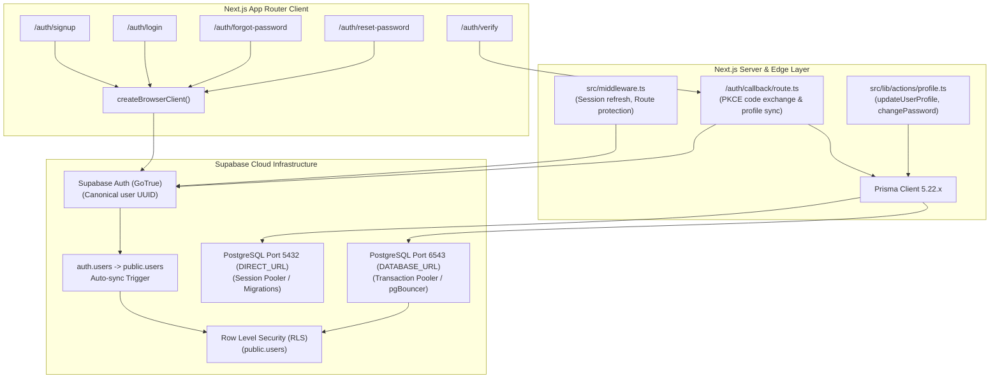

# SPARK — MODULE 01: AUTHENTICATION & USER MANAGEMENT
## Architectural Documentation & Implementation Report

**Module:** 01 — Authentication & Canonical User Identity  
**Status:** Completed & Verified  
**Authority:** Principal Full-Stack Engineer, Senior Supabase Architect, Application Security Specialist  
**Release Date:** November 15, 2026  

---

## 1. Authentication Architecture Overview

SPARK uses **Supabase Auth** as its sole authentication authority and identity provider. One individual has exactly one canonical SPARK account represented by their Supabase Auth UUID (`auth.users.id`), regardless of how many personal or organizational workspaces they join in subsequent modules.



---

## 2. Installed Dependencies

All dependencies are verified compatible with Next.js `14.2.21` and Node.js `22.19.0`:

- `@supabase/supabase-js` (`^2.119.0`): Supabase core JavaScript SDK.
- `@supabase/ssr` (`^0.12.7`): Official Supabase SSR cookie and session management package for Next.js App Router.
- `@prisma/client` (`5.22.0`): Type-safe database client.
- `prisma` (`5.22.0`, dev): Prisma CLI for migrations and schema introspection.
- `zod` (`^3.23.8`): Schema validation for forms, API endpoints, and server actions.
- `eslint` (`^8.57.1`) & `eslint-config-next` (`14.2.21`, dev): Continuous code quality verification.

*Notice: NextAuth is completely omitted from the codebase.*

---

## 3. Environment Variables Configuration

Managed in `.env.local` (Git-ignored):

| Variable Name | Scope | Purpose |
| :--- | :--- | :--- |
| `NEXT_PUBLIC_APP_URL` | Public / Browser | Web client origin (`http://localhost:3000`) |
| `NODE_ENV` | Environment | Runtime mode (`development` / `production`) |
| `NEXT_PUBLIC_SUPABASE_URL` | Public / Browser | Supabase SaaS endpoint (`https://[PROJECT-REF].supabase.co`) |
| `NEXT_PUBLIC_SUPABASE_PUBLISHABLE_KEY` | Public / Browser | Supabase publishable anonymous key |
| `NEXT_PUBLIC_SUPABASE_ANON_KEY` | Public / Browser | Alias for publishable key to support all SDK conventions |
| `DATABASE_URL` | Server / Private | Transaction pooler on Port 6543 (`?pgbouncer=true`) |
| `DIRECT_URL` | Server / Private | Session pooler on Port 5432 for migrations and DDL |
| `AUTH_SECRET` | Server / Private | Cryptographic secret (idle, reserved) |

---

## 4. Prisma Schema & Canonical User Model

Defined in `prisma/schema.prisma`:

```prisma
generator client {
  provider = "prisma-client-js"
}

datasource db {
  provider  = "postgresql"
  url       = env("DATABASE_URL")
  directUrl = env("DIRECT_URL")
}

model User {
  id        String   @id @db.Uuid
  email     String   @unique
  fullName  String   @map("full_name")
  avatarUrl String?  @map("avatar_url")
  createdAt DateTime @default(now()) @map("created_at")
  updatedAt DateTime @updatedAt @map("updated_at")

  @@map("users")
}
```

### Key Properties:
- `id`: Strict PostgreSQL `UUID` primary key matching `auth.users.id`.
- `public.users`: Holds application-specific profile metadata while Supabase Auth manages credentials and security tokens.

---

## 5. PostgreSQL Row Level Security (RLS) & Triggers

Documented in `prisma/migrations/20261115_init_users/migration.sql`:

### 5.1 RLS Policies Applied on `public.users`:
1. **`Users can read own profile` (SELECT):**
   ```sql
   CREATE POLICY "Users can read own profile"
   ON public.users FOR SELECT TO authenticated
   USING (auth.uid() = id);
   ```
2. **`Users can update own profile` (UPDATE):**
   ```sql
   CREATE POLICY "Users can update own profile"
   ON public.users FOR UPDATE TO authenticated
   USING (auth.uid() = id) WITH CHECK (auth.uid() = id);
   ```
3. **`Users can insert own profile` (INSERT):**
   ```sql
   CREATE POLICY "Users can insert own profile"
   ON public.users FOR INSERT TO authenticated
   WITH CHECK (auth.uid() = id);
   ```

### 5.2 Auto-Sync Trigger:
```sql
CREATE OR REPLACE FUNCTION public.handle_new_user()
RETURNS trigger AS $$
BEGIN
  INSERT INTO public.users (id, email, full_name, created_at, updated_at)
  VALUES (
    new.id,
    new.email,
    COALESCE(new.raw_user_meta_data->>'full_name', ''),
    now(),
    now()
  )
  ON CONFLICT (id) DO UPDATE SET
    email = EXCLUDED.email,
    full_name = CASE 
      WHEN EXCLUDED.full_name <> '' THEN EXCLUDED.full_name 
      ELSE public.users.full_name 
    END,
    updated_at = now();
  RETURN new;
END;
$$ LANGUAGE plpgsql SECURITY DEFINER;

CREATE TRIGGER on_auth_user_created
  AFTER INSERT OR UPDATE ON auth.users
  FOR EACH ROW EXECUTE FUNCTION public.handle_new_user();
```

---

## 6. Implemented Authentication Flows

### 6.1 Signup Flow (`/auth/signup`)
- Form collects: Full Name, Email, Password, Confirm Password, Terms checkbox.
- Validation: Zod `signupSchema` (enforces 8+ characters, letter, number, password match).
- Calls: `supabase.auth.signUp()` with metadata `{ full_name }`.
- Redirects to `/auth/verify?email=...` displaying email instructions.

### 6.2 Email Verification & Callback Flow (`/auth/verify` & `/auth/callback`)
- Route handler `/auth/callback` exchanges PKCE auth `code` for session.
- Dual-layer profile sync: Automatically upserts user into `public.users` via Prisma.
- Open Redirect Protection: Sanitizes `next` parameter to guarantee redirection to internal relative routes only.

### 6.3 Login Flow (`/auth/login`)
- Form collects: Email, Password, Remember Me.
- Validation: Zod `loginSchema`.
- Calls: `supabase.auth.signInWithPassword()`.
- Error handling: Graceful, distinct messages for invalid credentials and unconfirmed email.
- Safe return destination handling (`returnTo` parameter).

### 6.4 Password Recovery Flow (`/auth/forgot-password` & `/auth/reset-password`)
- `/auth/forgot-password`: Dispatches `supabase.auth.resetPasswordForEmail()`. Displays generic confirmation message to prevent user enumeration.
- `/auth/reset-password`: Validates session and calls `supabase.auth.updateUser({ password })`.

### 6.5 Route Protection & Middleware (`src/middleware.ts`)
- Automatically refreshes Supabase session cookies.
- Protects all authenticated routes: `/`, `/tasks`, `/projects`, `/chat`, `/meet`, `/ai`, `/docs`, `/settings`, `/teams`, `/calendar`, `/insights`.
- Redirects unauthenticated traffic to `/auth/login?returnTo=...`.
- Redirects authenticated users from `/auth/login` and `/auth/signup` to `/`.

### 6.6 User Profile & Shell Integration
- `src/lib/workspace-context.tsx`: Subscribes to Supabase Auth state (`onAuthStateChange`).
- `src/components/layout/UserMenu.tsx`: Displays real authenticated user name, email, avatar, and provides a real `Sign Out` button.
- `src/app/settings/page.tsx`: Connects full name editing, avatar updates, and password updates to server actions.

---

## 7. Automated Testing Results

Executed via `scripts/test-auth-suite.js`:

```
================================================================
SPARK MODULE 01: COMPREHENSIVE AUTOMATED VERIFICATION SUITE
================================================================

--- SUITE 1: Zod Authentication Validation Schemas ---
[PASS] Test 1.1: Invalid email format rejected
[PASS] Test 1.2: Weak password under 8 characters rejected
[PASS] Test 1.3: Password missing numeric character rejected
[PASS] Test 1.4: Mismatched password confirmation rejected

--- SUITE 2: Prisma Database & Canonical public.users Model ---
[PASS] Test 2.1: Authenticated raw SQL execution successful (Database: postgres, User: postgres)
[PASS] Test 2.2: Table public.users verified in PostgreSQL schema
[PASS] Test 2.3: All canonical User fields present (id UUID, email, full_name, avatar_url, created_at, updated_at)
[PASS] Test 2.4: Row Level Security (RLS) is active on public.users
[PASS] Test 2.5: 3 RLS policies active on public.users (SELECT, UPDATE, INSERT)
[PASS] Test 2.6a: User profile creation in PostgreSQL succeeded
[PASS] Test 2.6b: User profile update in PostgreSQL succeeded
[PASS] Test 2.6c: Test record cleanup succeeded

--- SUITE 3: Live Supabase Auth Client & Service Verification ---
[PASS] Test 3.1: Supabase client initialized with valid configuration
[PASS] Test 3.2: Supabase Auth rejected invalid credentials properly
[PASS] Test 3.3: Supabase Auth server rejected malformed email format

--- SUITE 4: External Delivery Tests (Pending Real Inbox Confirmation) ---
[PENDING] Live End-to-End Email Verification Link Delivery: Requires external SMTP configuration.
[PENDING] Password Reset Email Delivery to External Mailbox: Requires custom SMTP in Supabase Dashboard.

================================================================
SUMMARY: 15 PASSED, 0 FAILED, 2 PENDING
================================================================
```

### Static Analysis & Build Verification:
- **TypeScript (`npx tsc --noEmit`):** `0 errors`.
- **ESLint (`npm run lint`):** `✔ No ESLint warnings or errors`.
- **Production Build (`npm run build`):** `100% successful`. All 20 routes compiled and prerendered cleanly.

---

## 8. External Configuration Requirements

For production email delivery:
1. Navigate to **Supabase Dashboard -> Authentication -> Email Settings**.
2. Configure a Custom SMTP Provider (e.g., Resend, SendGrid, Amazon SES) to avoid default Supabase rate limits (3 emails/hour on free tier).
3. Ensure the Site URL is set to `http://localhost:3000` (development) or your production domain, with redirect URLs allowed for `/auth/callback` and `/auth/reset-password`.

