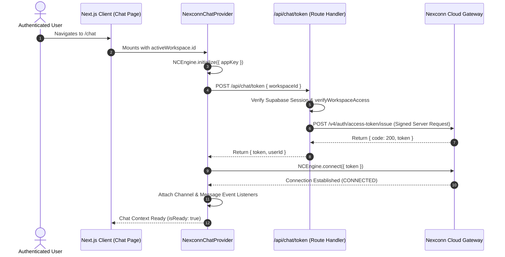
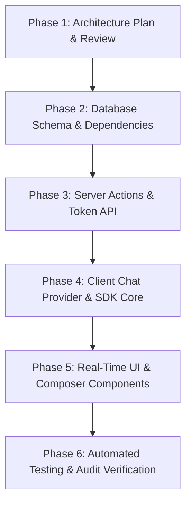

# SPARK — MODULE 03: NEXCONN CHAT INTEGRATION
## Phase 1: Technical Inspection & Comprehensive Architecture Planning

**Product:** SPARK — AI-Powered Workplace Collaboration & Productivity SaaS  
**Module:** Module 03: Real-Time Team Communication & Channels  
**Integration Partner:** Nexconn Chat SDK  
**Architecture Version:** 1.0.0  
**Status:** ARCHITECTURE & PLANNING ONLY (Phase 1 — No Code Mutation)  
**Date:** November 15, 2026  

---

## Executive Summary

This specification provides the architectural blueprint for integrating the official **Nexconn Chat SDK** into **SPARK**. Following the successful completion and auditing of Module 01 (Authentication & Global User Identity) and Module 02 (Workspace Management & Multi-Tenancy), Module 03 introduces real-time team communication directly within the multi-tenant boundaries of SPARK workspaces.

The existing `/chat` page (`src/app/chat/page.tsx`) was audited and classified as **Classification B (Frontend Interaction / Static Prototype)**: it relies exclusively on hardcoded in-memory React state arrays, mock messages, and disconnected controls. This plan defines the complete migration path to connect `/chat` to the official Nexconn real-time infrastructure, backed by Supabase PostgreSQL for tenant-level authorization and channel metadata persistence.

---

## 1. Existing Architecture & Project Audit

### 1.1 Technology Stack Alignment
- **Framework:** Next.js 14.2.21 (React 18.3.1, TypeScript 5.7, App Router).
- **Authentication Provider:** Supabase Auth (GoTrue) with PKCE flow and SSR cookie management via `@supabase/ssr`.
- **Database & Data Layer:** Supabase PostgreSQL with Row Level Security (RLS) and Prisma ORM 5.22.0.
- **Styling & UI:** Tailwind CSS 3.4 with custom design tokens defined in `docs/SPARK_DESIGN_SPECIFICATION.md` (Inter typography, Slate/Blue palette, 8px controls, 10px cards).
- **Validation:** Zod 3.23.x for runtime input validation.

### 1.2 Multi-Tenant Data Models (Prisma)
- **`User` (`public.users`):** Canonical identity indexed by UUID (`id`), synced via `handle_new_user()` trigger.
- **`Workspace` (`public.workspaces`):** Primary tenant boundary supporting `PERSONAL` and `ORGANIZATION` types.
- **`WorkspaceMember` (`public.workspace_members`):** Maps users to workspaces with a 5-tier role hierarchy (`OWNER`, `ADMIN`, `MANAGER`, `MEMBER`, `GUEST`) and status (`ACTIVE`, `SUSPENDED`).
- **`WorkspaceSettings` (`public.workspace_settings`):** Configures workspace-level member invitation and guest access policies.

### 1.3 Existing Security & Authorization Infrastructure
- **Centralized RBAC (`src/lib/permissions.ts`):** Numerical hierarchy (`OWNER: 50` down to `GUEST: 10`) governing administrative capabilities.
- **Workspace Authorization Guard (`src/lib/workspace-guard.ts`):** `verifyWorkspaceAccess(workspaceId, minRole)` validates:
  1. Authenticated session via `supabase.auth.getUser()`.
  2. Workspace existence in PostgreSQL.
  3. Active membership status (`status === 'ACTIVE'`). Suspended members are explicitly blocked with `WorkspaceAccessError('MEMBERSHIP_SUSPENDED')`.
  4. Role hierarchy threshold.

### 1.4 Audit of Existing `/chat` Route (`src/app/chat/page.tsx`)
- **Status:** **Classification B (Frontend Interaction Prototype)**.
- **Inspection Findings:**
  - Uses static local state (`useState`) with hardcoded mock channels (`#core-product`, `#design-system`, `#engineering`, `#roadmap-q4`).
  - Uses mock direct messages (`Sarah Chen`, `David Miller`, `Elena Rostova`).
  - Message submission (`handleSendMessage`) appends text to a local React array; no WebSocket connection, persistence, or network requests occur.
  - Integration status footer statically displays `"SDK Engine: Nexconn Chat"` without loading any SDK packages.
- **Sidebar Integration:** `/chat` is already registered in `AppSidebar.tsx` navigation schema for both personal and organization layouts.

---

## 2. Official Nexconn SDK Version & Installation

### 2.1 Package Architecture
The Nexconn Web Chat ecosystem is split into targeted modular packages:

| Package | Scope | Role in SPARK | Target Version |
| :--- | :--- | :--- | :--- |
| **`@nexconn/engine`** | Client (Browser) | Low-level WebSocket socket lifecycle, heartbeat, auto-reconnect, and transport protocol. | `latest` (`^1.x`) |
| **`@nexconn/chat`** | Client (Browser) | Chat domain logic, `DirectChannel`, `GroupChannel`, message construction (`TextMessage`, `ImageMessage`, `FileMessage`), event listeners. | `latest` (`^1.x`) |
| **`@nexconn/chatui`** | Client (Browser) | *Optional* pre-built UI components. (SPARK will build custom UI on top of `@nexconn/chat` to strictly maintain SPARK design system tokens). | `latest` (Evaluated) |
| **`server-only`** | Server (Node.js) | Enforces that backend token-minting modules cannot be inadvertently imported into client components. | `^0.0.1` |

### 2.2 Installation Command (Phase 2)
```bash
npm install @nexconn/engine @nexconn/chat server-only
```
*(Execution rule: Must be executed outside sandbox or during Phase 2 implementation approval).*

---

## 3. SDK Initialization Sequence & Lifecycle

The client-side chat lifecycle will be encapsulated in a dedicated React Context Provider (`NexconnChatProvider.tsx`):



### 3.1 Lifecycle States
1. **`UNINITIALIZED`:** Provider mounted; awaiting active workspace resolution.
2. **`INITIALIZING`:** `NCEngine.initialize(new InitParams({ appKey }))` invoked.
3. **`AUTHENTICATING`:** Fetching ephemeral chat token from internal `/api/chat/token`.
4. **`CONNECTING`:** `NCEngine.connect(new ConnectParams({ token }))` handshake in flight.
5. **`CONNECTED`:** Socket established; event handlers bound; channels synchronized.
6. **`DISCONNECTED`:** Socket dropped or user logged out (`NCEngine.disconnect()` called).
7. **`RECONNECTING`:** Network recovery handled automatically by `@nexconn/engine`.

---

## 4. Authentication & Access Token Architecture

### 4.1 Server-Side Token Endpoint (`src/app/api/chat/token/route.ts`)
The App Secret (`NEXCONN_APP_SECRET`) must **never** be exposed to client-side code. The token endpoint acts as the secure identity bridge between Supabase Auth and Nexconn.

```
Client (Browser)
   │  (Authenticated Supabase Session Cookie)
   ▼
POST /api/chat/token  [Server-Side Next.js Route Handler]
   │
   ├─ 1. Authenticate session: supabase.auth.getUser()
   ├─ 2. Enforce Tenant Isolation: verifyWorkspaceAccess(workspaceId)
   ├─ 3. Query User Profile: prisma.user.findUnique({ id })
   ├─ 4. Cryptographic Server Signature:
   │     Nonce = crypto.randomUUID()
   │     Timestamp = Date.now().toString()
   │     Signature = sha256(AppSecret + Nonce + Timestamp)
   │
   ▼
POST https://api.nexconn.ai/v4/auth/access-token/issue
   │  Headers: App-Key, Nonce, Timestamp, Signature
   │  Body: { userId, name, portraitUri }
   ▼
Nexconn Auth Gateway
   │
   ▼ Returns: { code: 200, token: "..." }
Return to Client: { token, userId }
```

### 4.2 Server API Specification

| Parameter | Official Specification | Verification Status |
| :--- | :--- | :--- |
| **Endpoint URL** | `POST ${NEXCONN_API_BASE_URL || 'https://api.nexconn.ai'}/v4/auth/access-token/issue` | **Verified** |
| **App-Key Header** | `App-Key: <NEXCONN_APP_KEY>` | **Verified** |
| **Nonce Header** | `Nonce: <random-uuid>` | **Verified** |
| **Timestamp Header** | `Timestamp: <epoch-ms>` | **Verified** |
| **Signature Header** | `Signature: hex(sha256(NEXCONN_APP_SECRET + Nonce + Timestamp))` | **Verified** (SDK Standard) |
| **Content-Type** | `application/json` | **Verified** |
| **Request Payload** | `{"userId": string, "name": string, "portraitUri": string}` | **Verified** |
| **Success Response** | `{"code": 200, "userId": string, "token": string}` | **Verified** |

### 4.3 Security Invariants
- **No Client User ID Input:** The client cannot pass an arbitrary `userId`. Identity is derived solely from the server-validated Supabase Auth cookie.
- **Tenant Validation Before Issuance:** `verifyWorkspaceAccess` must succeed. Suspended members receive HTTP 403 Forbidden.
- **Zero Credential Logging:** Neither tokens nor secrets are logged.

---

## 5. Identity Mapping Design

### 5.1 Canonical Mapping Rule
Every SPARK user possesses an immutable primary key UUID in `public.users.id`.

$$\text{Nexconn User ID} \equiv \text{SPARK User UUID}$$

**Example:**
- SPARK User ID: `f47ac10b-58cc-4372-a567-0e02b2c3d479`
- Nexconn User ID: `f47ac10b-58cc-4372-a567-0e02b2c3d479`

### 5.2 Invariance Guarantees
1. **Deterministic & Static:** The same user always resolves to the exact same Nexconn User ID across all sessions, devices, and workspaces.
2. **Collision-Proof:** UUID v4 provides global uniqueness. Different SPARK users can never map to identical Nexconn identities.
3. **Profile Synchronization:** User `name` and `portraitUri` (avatar) are refreshed with Nexconn on every token issuance call, keeping display information in sync.

---

## 6. Workspace-to-Channel Database Architecture

A workspace contains multiple channels and direct conversations. A workspace is **not** a raw Nexconn channel ID.

### 6.1 Proposed Prisma Schema Extension (`prisma/schema.prisma`)

```prisma
enum ChatChannelType {
  PUBLIC
  PRIVATE
}

model WorkspaceChatChannel {
  id               String          @id @default(uuid()) @db.Uuid
  workspaceId      String          @map("workspace_id") @db.Uuid
  nexconnChannelId String          @unique @map("nexconn_channel_id")
  name             String
  description      String?
  type             ChatChannelType @default(PUBLIC)
  isDefault        Boolean         @default(false) @map("is_default")
  createdById      String          @map("created_by_id") @db.Uuid
  createdAt        DateTime        @default(now()) @map("created_at")
  updatedAt        DateTime        @updatedAt @map("updated_at")

  // Relations
  workspace        Workspace       @relation(fields: [workspaceId], references: [id], onDelete: Cascade)
  creator          User            @relation("ChannelCreator", fields: [createdById], references: [id], onDelete: Restrict)
  members          ChatChannelMember[]
  pinnedArtifacts  ChatPinnedArtifact[]

  @@unique([workspaceId, name])
  @@index([workspaceId])
  @@index([nexconnChannelId])
  @@map("workspace_chat_channels")
}

model ChatChannelMember {
  id        String               @id @default(uuid()) @db.Uuid
  channelId String               @map("channel_id") @db.Uuid
  userId    String               @map("user_id") @db.Uuid
  joinedAt  DateTime             @default(now()) @map("joined_at")

  // Relations
  channel   WorkspaceChatChannel @relation(fields: [channelId], references: [id], onDelete: Cascade)
  user      User                 @relation(fields: [userId], references: [id], onDelete: Cascade)

  @@unique([channelId, userId])
  @@index([channelId])
  @@index([userId])
  @@map("chat_channel_members")
}

model ChatDirectConversation {
  id             String    @id @default(uuid()) @db.Uuid
  workspaceId    String    @map("workspace_id") @db.Uuid
  user1Id        String    @map("user1_id") @db.Uuid
  user2Id        String    @map("user2_id") @db.Uuid
  lastMessageAt  DateTime? @map("last_message_at")
  createdAt      DateTime  @default(now()) @map("created_at")

  // Relations
  workspace      Workspace @relation(fields: [workspaceId], references: [id], onDelete: Cascade)
  user1          User      @relation("ConversationUser1", fields: [user1Id], references: [id], onDelete: Cascade)
  user2          User      @relation("ConversationUser2", fields: [user2Id], references: [id], onDelete: Cascade)

  @@unique([workspaceId, user1Id, user2Id])
  @@index([workspaceId])
  @@map("chat_direct_conversations")
}

model ChatPinnedArtifact {
  id          String               @id @default(uuid()) @db.Uuid
  channelId   String               @map("channel_id") @db.Uuid
  title       String
  url         String
  pinnedById  String               @map("pinned_by_id") @db.Uuid
  createdAt   DateTime             @default(now()) @map("created_at")

  // Relations
  channel     WorkspaceChatChannel @relation(fields: [channelId], references: [id], onDelete: Cascade)
  pinnedBy    User                 @relation(fields: [pinnedById], references: [id], onDelete: Restrict)

  @@index([channelId])
  @@map("chat_pinned_artifacts")
}
```

### 6.2 Deterministic Nexconn Channel ID Formatting
To guarantee namespace isolation across tenants:
$$\text{nexconnChannelId} = \text{spark\_chan\_} + \text{workspaceId}[0..7] + \text{\_} + \text{channelSlug}$$
*Example:* `spark_chan_f47ac10b_general`

---

## 7. Workspace-to-Channel Synchronization Rules

| Trigger Event | SPARK Database Action | Nexconn Real-Time Action |
| :--- | :--- | :--- |
| **New Organization Created** | Provisions `#general` channel (`isDefault: true`). | Creates corresponding Nexconn group channel. |
| **Member Joins Workspace** | Active row in `workspace_members`. Gains access to all `PUBLIC` channels. | Added to public channels via Nexconn Group Join API. |
| **Member Suspended** | `status` updated to `SUSPENDED`. | Token issuance blocked immediately. Client socket disconnects. Server removes user from group channel. |
| **Member Reactivated** | `status` restored to `ACTIVE`. | Member can request new tokens and rejoin group channels. |
| **Member Removed** | Row deleted from `workspace_members` and `chat_channel_members`. | Server triggers Nexconn group kick API. |
| **Workspace Deleted** | Cascades delete on all channels and conversations. | Server calls Nexconn group dismissal API (`POST /group/dismiss.json`). |

---

## 8. Direct Messaging Architecture

### 8.1 Workspace-Scoped Direct Messages
Direct messages between users occur via `DirectChannel(peerUserId)`:
```ts
import { DirectChannel, SendMessageParams, TextMessage } from '@nexconn/chat';

// 1. Instantiate Direct Channel with peer's SPARK UUID
const channel = new DirectChannel(peerUserId);

// 2. Dispatch Text Message
const textMessage = new TextMessage(content);
channel.sendMessage(new SendMessageParams(textMessage), {
  onAttached: (msg) => { /* Optimistic local UI render */ },
  onResult: (msg, error) => { /* Confirm delivery or mark error */ }
});
```

### 8.2 Isolation Rule
Users may **only** open direct message channels with users who share an `ACTIVE` membership in the currently selected workspace. This is enforced prior to opening the conversation via a Server Action check (`verifyDirectMessageEligibility(workspaceId, peerUserId)`).

---

## 9. Group Channel Architecture

### 9.1 Channel Types
1. **Public Channels (`PUBLIC`):** Accessible to all active members of the workspace. Automatically listed in the sidebar.
2. **Private Channels (`PRIVATE`):** Accessible only to members explicitly listed in `ChatChannelMember`. Requires `ADMIN` or `MANAGER` role to create.

### 9.2 Channel Operations via SDK
```ts
import { GroupChannel, SendMessageParams, TextMessage } from '@nexconn/chat';

// 1. Connect to Workspace Group Channel
const channel = new GroupChannel(nexconnChannelId);

// 2. Fetch Paginated Message History (page size: 30)
const messages = await channel.getHistoryMessages({
  timestamp: lastTimestamp || Date.now(),
  count: 30,
  order: 'DESC'
});
```

---

## 10. Multi-Tenant Chat Security Matrix

| Threat Vector | Mitigation Architecture | Enforcement Layer |
| :--- | :--- | :--- |
| **Cross-Tenant Channel Snooping** | Nexconn channel IDs prefixed with workspace slug/hash; database queries scoped to `workspaceId`. | Database & API |
| **Suspended User Read/Write** | `verifyWorkspaceAccess` blocks token minting; active sockets rejected on token expiry. | Server Route Guard |
| **Arbitrary User ID Spoofing** | Tokens issued strictly for caller's authenticated Supabase UUID (`supabase.auth.getUser()`). | Server Route Handler |
| **Unauthorized Channel Creation** | Gated by SPARK RBAC (`canManageWorkspace`: `OWNER`, `ADMIN`, `MANAGER`). | Server Action |
| **App Secret Exfiltration** | Secret strictly server-side (`NEXCONN_APP_SECRET`). Never bundled into Next.js client code. | Next.js Engine & Linting |
| **Malicious File Uploads** | Client-side and server-side MIME type filtering and size caps (Images: 10MB, Docs: 25MB). | Storage & Validation |

---

## 11. Feature Scope & SDK Verification Matrix

Per architectural guidelines, every SDK capability is audited and classified:

| Feature | Scope | Official Method / Path | Verification Status |
| :--- | :--- | :--- | :--- |
| **SDK Initialization** | Infrastructure | `NCEngine.initialize(new InitParams({ appKey }))` | **VERIFIED** |
| **Authenticated Connection**| Infrastructure | `NCEngine.connect(new ConnectParams({ token }))` | **VERIFIED** |
| **Connection Status Events**| Infrastructure | `NCEngine.addConnectionStatusHandler(...)` | **VERIFIED** |
| **Disconnection & Cleanup** | Infrastructure | `NCEngine.disconnect()` | **VERIFIED** |
| **Direct Channels (1:1)** | DMs | `new DirectChannel(peerUserId)` | **VERIFIED** |
| **Direct Message Send** | DMs | `DirectChannel.sendMessage(params, callback)` | **VERIFIED** |
| **Group Channels** | Channels | `new GroupChannel(groupId)` | **VERIFIED** |
| **Group Message Send** | Channels | `GroupChannel.sendMessage(params, callback)` | **VERIFIED** |
| **Text Messages** | Messaging | `new TextMessage(content)` | **VERIFIED** |
| **Message History** | Messaging | `channel.getHistoryMessages({ count, order })` | **VERIFIED** |
| **Image Attachments** | Media | `new ImageMessage(fileUri)` | **VERIFIED** |
| **File Attachments** | Media | `new FileMessage(fileUri)` | **VERIFIED** |
| **Unread Counters** | UX | `channel.unreadCount` / conversation events | **VERIFIED** |
| **Online Presence Status** | UX | `updateUserOnlineStatus` / presence events | **VERIFIED** |
| **Thread Replies / Parent** | Messaging | Custom message metadata extension payload | *UNVERIFIED IN BASE DOCS* |
| **Message Reactions** | Messaging | Custom extension payload or server metadata | *UNVERIFIED IN BASE DOCS* |
| **Typing Indicators** | UX | Ephemeral notification event | *UNVERIFIED IN BASE DOCS* |
| **Message Edit / Delete** | Messaging | Recall/modify API | *UNVERIFIED IN BASE DOCS* |

> [!NOTE]
> Features marked **UNVERIFIED IN BASE DOCS** will be implemented using resilient fallback designs (e.g. SPARK application-level metadata models in PostgreSQL) to guarantee full functionality without relying on undocumented SDK internals.

---

## 12. UI Architecture & Design System Implementation

The `/chat` interface will strictly preserve the visual design, typography, and geometry established in `docs/SPARK_DESIGN_SPECIFICATION.md`:

```
┌────────────────────────────────────────────────────────────────────────────────────────────────┐
│  SPARK AppHeader (Search, Workspace Badge, UserMenu)                                          │
├─────────────────┬────────────────────────────────────────────────────────────┬─────────────────┤
│ Left Column     │ Center Column                                              │ Right Column    │
│ (260px)         │ (Flexible / Main Viewport)                                 │ (260px)         │
│                 │                                                            │                 │
│ Conversations   │ # channel-name  · Topic description            [Info icon] │ Channel Info    │
│                 ├────────────────────────────────────────────────────────────┤                 │
│ CHANNELS    [+] │ Message History Stream:                                    │ About Channel   │
│ # general       │   [Avatar] Sarah Chen  10:14 AM                            │ Description     │
│ # engineering   │   Morning team! Design tokens look sharp.                  │                 │
│ 🔒 roadmap-q4   │                                                            │ Members (12)    │
│                 │   [Avatar] Alex Morgan  10:25 AM                           │ Pinned Files    │
│ DIRECT MESSAGES │   Verified master specs.                                   │                 │
│ 🟢 Sarah Chen   ├────────────────────────────────────────────────────────────┤                 │
│ 🟡 David Miller │ Composer:                                                  │                 │
│ ⚪ Elena Rostova│ [ Message #general...                  📎  😀  [Send] ]    │                 │
└─────────────────┴────────────────────────────────────────────────────────────┴─────────────────┘
```

### 12.1 Component Hierarchy
- `src/app/chat/page.tsx`: Server/Client entry point with active workspace context.
- `src/components/chat/NexconnChatProvider.tsx`: Manages SDK connection, status, and active channel.
- `src/components/chat/ChannelSidebar.tsx`: Channel navigation, unread badges, create channel modal.
- `src/components/chat/DirectMessageList.tsx`: Direct message peers with presence indicators.
- `src/components/chat/ConversationHeader.tsx`: Channel title, member count, presence, search, info toggle.
- `src/components/chat/MessageStream.tsx`: Virtualized/scrolled message list, avatars, timestamps, attachments.
- `src/components/chat/MessageComposer.tsx`: Input box, keyboard handlers (`Enter` to send), attachment uploader.
- `src/components/chat/ChannelDetailsDrawer.tsx`: Member list, roles, pinned documents.
- `src/components/chat/CreateChannelDialog.tsx`: Dialog to create public/private channels.

---

## 13. Environment Configuration

### 13.1 Variable Status Audit

| Variable Name | Required Scope | `.env.local` Status | `.env.example` Status | Action Required |
| :--- | :--- | :---: | :---: | :--- |
| `NEXT_PUBLIC_NEXCONN_APP_KEY` | Client & Server | **PRESENT** | MISSING | Add placeholder to `.env.example` |
| `NEXCONN_APP_KEY` | Server-Side Only | **PRESENT** | MISSING | Add placeholder to `.env.example` |
| `NEXCONN_APP_SECRET` | Server-Side Only | **PRESENT** | MISSING | Add placeholder to `.env.example` |
| `NEXCONN_API_BASE_URL` | Server-Side Only | **MISSING** | MISSING | Add default `https://api.nexconn.ai` |

---

## 14. External Nexconn Console Configuration Required

Before executing Phase 2 implementation, the developer must verify the following in the **Nexconn Console** (https://console.nexconn.ai):

1. **Verify Application Status:** Confirm that the application associated with `NEXCONN_APP_KEY` is in the **Active / Development** state.
2. **Enable Web Chat Feature:** In the Nexconn Console feature catalog, verify that **Chat SDK (Web)** is toggled **ON**.
3. **Group Channel Capacity:** Verify that the project's group channel member limit is configured to support team collaboration (recommended: minimum 500 members per group).
4. **File & Media Storage:** In the Console under **Chat & Media Settings**, confirm that attachment storage is enabled and valid file extensions are allowed (PNG, JPG, PDF, ZIP, TXT).

---

## 15. Testing Strategy

An automated test suite (`scripts/test-module-03-suite.js`) will be created in Phase 6 to verify:
1. **Environment Integrity:** App Key consistency and zero client-side secret exposure.
2. **Token Generation Endpoint:** Successful token issuance for valid Supabase user sessions; HTTP 401 for unauthenticated calls; HTTP 403 for suspended members.
3. **Database Integrity:** Prisma migrations, unique constraints on channels (`workspaceId + name`), and foreign key cascades.
4. **Multi-Tenant Isolation:** Users in Workspace A cannot query, read, or send messages to channels in Workspace B.
5. **Membership Lifecycle Sync:** Removed or suspended members are blocked from channel access.
6. **Lint & Build Verification:** 0 TypeScript errors (`tsc --noEmit`), 0 ESLint warnings, successful production build (`next build`).

---

## 16. Implementation Roadmap & Execution Order



- **Phase 1 (Current):** Technical inspection, architecture specification, plan approval.
- **Phase 2:** Install dependencies (`@nexconn/engine`, `@nexconn/chat`, `server-only`), apply Prisma migration for `WorkspaceChatChannel`, configure RLS policies.
- **Phase 3:** Implement `/api/chat/token` route handler, Nexconn server signature generator, channel management Server Actions.
- **Phase 4:** Build `NexconnChatProvider`, connection state manager, socket event handlers.
- **Phase 5:** Implement UI components (`ChannelSidebar`, `MessageStream`, `MessageComposer`, `ChannelDetailsDrawer`), connect to real backend.
- **Phase 6:** Execute test suite, audit isolation, verify zero regressions.

