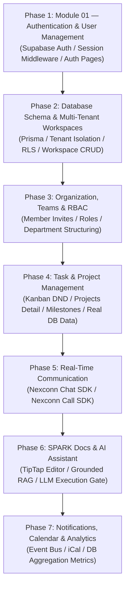

# SPARK — Comprehensive Initial Architecture and Implementation Audit

**Audit Date:** November 15, 2026  
**Auditor:** Senior Full-Stack Software Architect & QA Engineer  
**Audit Target:** SPARK Workplace SaaS (Initial Shell & Design System Implementation)  
**Status:** Audit Completed — Baseline Evaluation Prior to Module 01 Implementation  

---

## 1. Executive Summary

An architectural and technical audit was conducted on the SPARK codebase. The objective was to inspect the current state of the application shell, design system compliance, component architecture, database readiness, security baseline, and code quality before commencing functional module development.

### Key Audit Findings
1. **Design System & Shell Architecture:** **Fully Established & Compliant.** The visual design system, token scale, Inter typography, 4px spacing hierarchy, component geometry (8px controls, 10px cards, 12px dialogs), and responsive shell layout strictly adhere to `docs/SPARK_DESIGN_SPECIFICATION.md`.
2. **Current Implementation Tier:** **Frontend Prototype & Local State Interaction.** All pages, views, and navigation flows currently operate entirely on in-memory mock data and local React state. No live backend, persistence layer, or external SDK integration is currently connected.
3. **Database & Persistence:** **Zero Configuration (Not Started).** There is no Prisma ORM schema, no database connection string, and no Supabase client configured.
4. **Authentication & Authorization:** **Simulated Frontend Mock.** Login and Signup pages render accessible forms, but authentication is simulated using local state timers. There is no session token handling, password hashing, route protection middleware, or Row Level Security (RLS).
5. **External Services & SDKs:** **Pending Integration.** Nexconn Chat SDK, Nexconn Call SDK, and OpenAI / LLM APIs are represented by frontend layouts and mock flows; no SDK packages or API handlers are installed or configured.
6. **Code Quality & Build:** **Clean TypeScript & Production Build.** `npx tsc --noEmit` passed with 0 errors. `npm run build` compiled and prerendered 16/16 routes successfully. ESLint configuration is uninitialized.

---

## 2. Existing Project Architecture

### 2.1 File & Directory Tree
```
d:\SPARK\
├── docs\
│   └── SPARK_DESIGN_SPECIFICATION.md
├── src\
│   ├── app\
│   │   ├── ai\page.tsx
│   │   ├── auth\
│   │   │   ├── login\page.tsx
│   │   │   └── signup\page.tsx
│   │   ├── calendar\page.tsx
│   │   ├── chat\page.tsx
│   │   ├── docs\page.tsx
│   │   ├── insights\page.tsx
│   │   ├── meet\page.tsx
│   │   ├── projects\page.tsx
│   │   ├── settings\page.tsx
│   │   ├── tasks\page.tsx
│   │   ├── teams\page.tsx
│   │   ├── globals.css
│   │   ├── layout.tsx
│   │   └── page.tsx
│   ├── components\
│   │   ├── brand\
│   │   │   └── SparkLogo.tsx
│   │   ├── data\
│   │   │   ├── DataTable.tsx
│   │   │   └── FilterBar.tsx
│   │   ├── feedback\
│   │   │   ├── ConfirmDialog.tsx
│   │   │   ├── EmptyState.tsx
│   │   │   ├── ErrorState.tsx
│   │   │   └── LoadingState.tsx
│   │   ├── layout\
│   │   │   ├── AppHeader.tsx
│   │   │   ├── AppSidebar.tsx
│   │   │   ├── Breadcrumbs.tsx
│   │   │   ├── GlobalSearchModal.tsx
│   │   │   ├── NotificationMenu.tsx
│   │   │   ├── PageHeader.tsx
│   │   │   ├── ShellLayout.tsx
│   │   │   ├── UserMenu.tsx
│   │   │   └── WorkspaceSwitcher.tsx
│   │   ├── providers\
│   │   │   └── AppProviders.tsx
│   │   └── ui\
│   │       ├── avatar.tsx
│   │       ├── badge.tsx
│   │       ├── button.tsx
│   │       ├── card.tsx
│   │       ├── checkbox.tsx
│   │       ├── dialog.tsx
│   │       ├── dropdown.tsx
│   │       ├── input.tsx
│   │       ├── separator.tsx
│   │       ├── skeleton.tsx
│   │       ├── switch.tsx
│   │       ├── tabs.tsx
│   │       ├── textarea.tsx
│   │       └── tooltip.tsx
│   └── lib\
│       ├── mock-data.ts
│       ├── types.ts
│       ├── utils.ts
│       └── workspace-context.tsx
├── next-env.d.ts
├── next.config.mjs
├── package.json
├── postcss.config.js
├── tailwind.config.ts
└── tsconfig.json
```

### 2.2 Structural Deficiencies & Missing Files
- **Missing API Routes (`src/app/api`):** No API route handlers exist (e.g. `/api/auth`, `/api/tasks`, `/api/workspaces`).
- **Missing Auth Sub-Routes:**
  - `src/app/auth/verify/page.tsx` (Required by Spec Section 8)
  - `src/app/auth/forgot-password/page.tsx` (Linked from Login, currently 404)
  - `src/app/auth/reset-password/page.tsx` (Required by Spec Section 8)
- **Missing Database Directory:** No `prisma/` or `supabase/` directory exists.
- **Missing Environment Files:** No `.env`, `.env.example`, or `.env.local` files exist.
- **Missing Middleware:** No `middleware.ts` for server-side route guards, auth token validation, or workspace subdomain/tenant extraction.
- **Missing ESLint Config:** No `.eslintrc.json` or ESLint dependencies configured in `package.json`.

---

## 3. Design System Audit

Comparison against [docs/SPARK_DESIGN_SPECIFICATION.md](file:///d:/SPARK/docs/SPARK_DESIGN_SPECIFICATION.md):

| Design Element | Specification Requirement | Implemented State | Compliance | Observations / Inconsistencies |
| :--- | :--- | :--- | :---: | :--- |
| **Primary Palette** | `#2563EB`, `#1D4ED8`, `#EFF6FF` | `tailwind.config.ts` & `globals.css` | **Compliant** | Configured with exact hex codes and semantic utility names. |
| **Secondary Palette** | `#7C3AED`, `#F5F3FF` | `tailwind.config.ts` & `globals.css` | **Compliant** | Used strictly for AI indicators and tags; no decorative gradients. |
| **Surfaces & Backgrounds** | `#F8FAFC` (Bg), `#FFFFFF` (Surface), `#F1F5F9` (Secondary) | Configured in Tailwind tokens and CSS variables | **Compliant** | Accurate contrast and surface elevation throughout. |
| **Typography Scale** | Inter, system-ui; 24-28px page titles, 14px body | Configured in `globals.css` & layout components | **Compliant** | Strict font-weight hierarchy, no oversized typography. |
| **Spacing & Grid** | 4px-based grid (4, 8, 12, 16, 20, 24, 32, 40) | Standardized Tailwind increments (`p-1` to `p-10`) | **Compliant** | Consistent gutters, card padding, and control spacing. |
| **Component Geometry** | Inputs/Buttons: 8px, Cards: 10px, Modals: 12px | Custom Tailwind radius tokens (`control`, `card`, `modal`) | **Compliant** | Applied uniformly across all foundation components. |
| **Elevations & Shadows** | Minimal shadows, thin borders (`#E2E8F0`) preferred | `border border-slate-200`, subtle popover shadows | **Compliant** | Heavy drop shadows avoided; cards use crisp borders. |
| **Brand Identity** | SPARK geometric mark + Inter Bold wordmark | `src/components/brand/SparkLogo.tsx` | **Compliant** | Minimalist geometric 4-point star on blue ground. Clean SVG. |
| **Workspace Navigation** | Personal vs. Organization dynamic nav adaptation | `AppSidebar.tsx` & `WorkspaceSwitcher.tsx` | **Compliant** | Switches navigation links dynamically based on active workspace. |
| **Sidebar Copy** | Section label for organization navigation | `AppSidebar.tsx` line 88 | **Minor Bug** | Displays `"Workspace Workspace"` instead of `"Organization Workspace"`. |
| **Iconography** | Exclusively Lucide icons, no emojis | Applied across all navigation, buttons, and cards | **Compliant** | Zero emojis used; consistent 14-16px Lucide icons with text. |

---

## 4. Module-by-Module Functionality Matrix

Every module is classified under one of the four required tiers:
- **A. REAL FUNCTIONALITY:** Connected to a real backend or working application logic.
- **B. FRONTEND INTERACTION:** Buttons, dialogs, filters or controls work locally but are not persisted.
- **C. STATIC PROTOTYPE:** Visual UI exists but business functionality is not implemented.
- **D. NOT IMPLEMENTED:** Feature is absent.

| # | Module Name | Existing Pages | Existing Components | Classification | Backend Status | Database Status | Missing Functionality & Critical Dependencies |
| :--- | :--- | :--- | :--- | :---: | :---: | :---: | :--- |
| **1** | **Authentication & User Management** | `/auth/login`, `/auth/signup` | `Input`, `Button`, `Checkbox`, `SparkLogo` | **C. STATIC PROTOTYPE** | Not Connected | None | Real credential verification, password hashing, session tokens/cookies, email verification (`/auth/verify`), password reset flows (`/auth/forgot-password`, `/auth/reset-password`), profile editing. *Dep: Supabase Auth / Auth.js, bcrypt, mailer.* |
| **2** | **Workspace Management** | Accessible via Shell, `/settings` | `WorkspaceSwitcher`, `WorkspaceProvider` | **B. FRONTEND INTERACTION** | Not Connected | None | Switching between personal/org works in React state. Missing: Workspace creation modal, invite codes, member list management, tenant isolation, DB persistence. *Dep: Prisma / Supabase DB.* |
| **3** | **Organization & Team Management** | `/teams` | `DataTable`, `FilterBar`, `Avatar`, `Card` | **B. FRONTEND INTERACTION** | Not Connected | None | Search filter works on local array. Missing: Member invitation dispatch, team/department CRUD, role assignment, member deactivation. *Dep: Email service, Organization schema.* |
| **4** | **Roles & Permissions (RBAC)** | Surfaced in `UserMenu`, `WorkspaceSwitcher` | Badges, role types (`owner`, `admin`, `member`, `viewer`) | **C. STATIC PROTOTYPE** | Not Connected | None | Roles exist as string attributes on mock models. Missing: Server-side RBAC middleware, permission guards, policy evaluation, custom role creation. *Dep: CASL / Auth policy engine.* |
| **5** | **SPARK Chat** | `/chat` | 3-column layout, channel list, DM list, composer | **B. FRONTEND INTERACTION** | Not Connected | None | Local message append in state, channel selection, right info toggle. Missing: Nexconn Chat SDK integration, WebSockets, file attachment storage, message reactions, threads. *Dep: Nexconn Chat SDK, S3/Storage.* |
| **6** | **SPARK Meet** | `/meet` | In-call room grid, control bar, meeting list | **B. FRONTEND INTERACTION** | Not Connected | None | Local toggle for mic/cam, meeting room overlay toggle. Missing: Nexconn Call SDK integration, WebRTC media streams, screen capture API, meeting room creation API. *Dep: Nexconn Call SDK.* |
| **7** | **Notifications & Calendar** | `/calendar`, Header menu | `NotificationMenu`, 5-day calendar grid | **B. FRONTEND INTERACTION** | Not Connected | None | Mark read/all-read updates state and counter badge. Missing: Event trigger pipeline, webhooks, push notifications, full calendar CRUD, iCal sync, DB persistence. *Dep: Event bus, date-fns.* |
| **8** | **Project Management** | `/projects` | Project cards, health badges, progress bars, `FilterBar` | **B. FRONTEND INTERACTION** | Not Connected | None | Client-side filtering works. Missing: Project creation dialog, project detail view (`/projects/[id]`) with tabs (Overview, Board, List, Files, Activity), milestone tracking. *Dep: Project schema.* |
| **9** | **Task & Workflow Management** | `/tasks`, embedded in `/` | 5-column Kanban board, List table, `FilterBar` | **B. FRONTEND INTERACTION** | Not Connected | None | View mode switcher (List vs Board) and search filter work locally. Missing: Drag-and-drop (@dnd-kit), task detail drawer, task creation, status updates, comments, DB persistence. *Dep: Task schema.* |
| **10** | **SPARK Docs** | `/docs` | Doc cards, category badges, `FilterBar` | **B. FRONTEND INTERACTION** | Not Connected | None | Search filter works across mock docs. Missing: Rich-text / Markdown editor (TipTap / Lexical), document versioning, collaborative editing, folder tree, DB storage. *Dep: TipTap / Lexical.* |
| **11** | **SPARK AI Assistant** | `/ai` | AI chat canvas, suggestions, `ConfirmDialog` | **B. FRONTEND INTERACTION** | Not Connected | None | Form creates mock response with confirmation modal for actions. Missing: OpenAI / Gemini API route, streaming (Vercel AI SDK), workspace RAG vector embeddings, automated task execution. *Dep: AI SDK, Vector DB.* |
| **12** | **Meeting Intelligence** | None standalone | Summary settings pill | **D. NOT IMPLEMENTED** | Not Connected | None | Entirely absent. Missing: Audio transcription pipeline, automated action item extraction, meeting recording storage. *Dep: Speech-to-Text API, LLM summarization.* |
| **13** | **Dashboard & Analytics** | `/`, `/insights` | Metric cards, progress bars, health matrix, tasks table | **B. FRONTEND INTERACTION** | Not Connected | None | Dynamic Personal vs Org view toggle, tab switching between Dashboard and Component Specs. Missing: Database aggregation queries, live cycle time metrics, historical trends. *Dep: Analytics DB views.* |
| **14** | **Search & Navigation** | Global (All pages) | `GlobalSearchModal` (Cmd+K), `Breadcrumbs` | **B. FRONTEND INTERACTION** | Not Connected | None | Cmd+K opens modal, filters commands, executes `router.push`. Missing: Full-text indexing across DB entities (tasks, docs, messages), recent search history. *Dep: Full-text search engine.* |
| **15** | **Settings, Security & Audit** | `/settings` | Profile card, notification switches, workspace card | **B. FRONTEND INTERACTION** | Not Connected | None | Local state inputs with mock "Saved" feedback. Missing: Password update endpoint, 2FA/MFA, session revocation, audit log table, member management. *Dep: Security endpoints, Audit schema.* |

---

## 5. Technology Stack Verification

### 5.1 Package Dependencies Inspection (`package.json`)
```json
{
  "dependencies": {
    "class-variance-authority": "^0.7.1",
    "clsx": "^2.1.1",
    "lucide-react": "^0.468.0",
    "next": "^14.2.21",
    "react": "^18.3.1",
    "react-dom": "^18.3.1",
    "tailwind-merge": "^2.5.5"
  },
  "devDependencies": {
    "@types/node": "^20.17.10",
    "@types/react": "^18.3.17",
    "@types/react-dom": "^18.3.5",
    "autoprefixer": "^10.4.20",
    "postcss": "^8.4.49",
    "tailwindcss": "^3.4.16",
    "typescript": "^5.7.2"
  }
}
```

### 5.2 Verification Findings
| Target Dependency | Status in `package.json` | Actual Working Configuration Found | Assessment |
| :--- | :---: | :---: | :--- |
| **Next.js** | Installed (`^14.2.21`) | Yes (App Router, static compilation verified) | **Verified** |
| **React / React DOM** | Installed (`^18.3.1`) | Yes (Client & Server components verified) | **Verified** |
| **TypeScript** | Installed (`^5.7.2`) | Yes (`tsconfig.json`, strict mode, 0 errors) | **Verified** |
| **Tailwind CSS** | Installed (`^3.4.16`) | Yes (`tailwind.config.ts`, `globals.css` verified) | **Verified** |
| **Lucide React** | Installed (`^0.468.0`) | Yes (Used across all components) | **Verified** |
| **Supabase Client/Auth** | **Not Installed** | **None** | Must be installed during Module 01 |
| **Prisma ORM** | **Not Installed** | **None** | Must be installed during Database setup |
| **Nexconn Chat SDK** | **Not Installed** | **None** | Must be installed during Chat module |
| **Nexconn Call SDK** | **Not Installed** | **None** | Must be installed during Meet module |
| **OpenAI / AI SDK** | **Not Installed** | **None** | Must be installed during AI Assistant module |

---

## 6. Database Readiness

- **Prisma Schema:** **Absent.** No `prisma/schema.prisma` file exists in the repository.
- **Database Connection:** **Not Configured.** No database URL (`DATABASE_URL`) or connection pooling configuration exists.
- **Database Migrations:** **None.** No schema tables (`users`, `workspaces`, `organizations`, `tasks`, `projects`, `messages`, `documents`) exist.
- **Readiness Rating:** **0% (Requires initialization).**

---

## 7. Authentication Readiness

- **Provider Configuration:** **Absent.** Neither Supabase Auth nor Auth.js / NextAuth is wired up.
- **Session Management:** **Absent.** No HTTP-only session cookies, JWT verification, or session store exists.
- **Client Auth State:** Currently simulated in `src/lib/workspace-context.tsx` with a static user (`Alex Morgan`, `alex.morgan@spark.work`).
- **Route Guards & Middleware:** **Absent.** Navigating to any route (`/`, `/tasks`, `/projects`, `/settings`) is unauthenticated and completely open.
- **Password Security:** Forms capture password inputs in state, but there is no hashing (e.g. bcrypt/argon2) or backend submission logic.
- **Readiness Rating:** **10% (UI forms exist; backend auth layer absent).**

---

## 8. Security Gaps

1. **Unprotected Routes:** All application routes (`/tasks`, `/projects`, `/settings`, `/chat`, etc.) are publicly accessible without authentication.
2. **Missing Server-Side Authorization:** There is no server-side validation to verify whether a user belongs to `Acme Technologies` or `Nexconn Engineering`.
3. **No Row Level Security (RLS):** Because no database is connected, multi-tenant isolation relies solely on client-side state filtering.
4. **Environment Variables Unconfigured:** No `.env` template or secrets handling exists. API keys (when added) must not be exposed to the client bundle.
5. **No CSRF or Rate Limiting:** Form submissions lack CSRF tokens or submission rate limiters.
6. **Hardcoded Mock Identities:** Default user state in `workspace-context.tsx` grants administrative role without credentials.

---

## 9. Code Quality & Build Audit

### 9.1 Commands Executed & Results
- **TypeScript Verification (`npx tsc --noEmit`):**
  - **Result:** `Exit code 0`.
  - **Output:** Clean pass. No type mismatches, no missing properties, strict mode compliant.
- **Next.js Production Build (`npm run build`):**
  - **Result:** `Exit code 0`.
  - **Output:** 16 routes compiled and prerendered statically:
    - `○ /` (8.72 kB)
    - `○ /_not-found` (873 B)
    - `○ /ai` (3.94 kB)
    - `○ /auth/login` (3.13 kB)
    - `○ /auth/signup` (3.17 kB)
    - `○ /calendar` (1.89 kB)
    - `○ /chat` (4.63 kB)
    - `○ /docs` (3.18 kB)
    - `○ /insights` (2.37 kB)
    - `○ /meet` (4.28 kB)
    - `○ /projects` (4.24 kB)
    - `○ /settings` (2.95 kB)
    - `○ /tasks` (4.57 kB)
    - `○ /teams` (3.24 kB)
- **Linting (`npm run lint`):**
  - **Result:** `Exit code 1` (Interactive prompt: ESLint is unconfigured in the project).

### 9.2 Structural Code Assessment
- **Component Modularity:** High. Foundation components (`ui/`), layouts (`layout/`), feedback indicators (`feedback/`), and data presentation (`data/`) are cleanly decoupled.
- **Code Duplication:** Minimal. Design tokens and styles are unified via Tailwind and `utils.ts` (`cn`).
- **Dependencies:** Extremely lean (7 production dependencies). No bloat or unnecessary third-party bundles.
- **Mock Data Isolation:** Mock datasets are centralized in `src/lib/mock-data.ts` and `src/lib/workspace-context.tsx`, ready to be replaced with API queries.

---

## 10. Critical Issues to Resolve

Prioritized list of items required before production readiness:

1. **Initialize ESLint Configuration:** Install `eslint` and `eslint-config-next` to enable continuous linting in CI/CD.
2. **Fix Navigation Copy Bug in Sidebar:** Correct `"Workspace Workspace"` to `"Organization Workspace"` in `AppSidebar.tsx` (line 88).
3. **Implement Missing Authentication Sub-Pages:**
   - Create `src/app/auth/verify/page.tsx`
   - Create `src/app/auth/forgot-password/page.tsx`
   - Create `src/app/auth/reset-password/page.tsx`
4. **Establish Database Architecture:** Initialize Prisma schema with PostgreSQL / Supabase, defining tables for users, organizations, workspaces, and memberships.
5. **Implement Authentication Middleware:** Create `middleware.ts` to enforce session cookies, protect private routes, and redirect unauthenticated requests to `/auth/login`.

---

## 11. Recommended Implementation Sequence

To maintain architectural integrity and avoid regressions, the following sequence is recommended:



1. **Step 1: Module 01 — Authentication and User Management (NEXT TASK)**
   - Configure Supabase Auth / NextAuth.
   - Complete `/auth/login`, `/auth/signup`, `/auth/verify`, `/auth/forgot-password`.
   - Implement `middleware.ts` for route protection and session token validation.
2. **Step 2: Database & Workspace Persistence**
   - Initialize Prisma ORM with PostgreSQL database.
   - Model `User`, `Workspace`, `Organization`, and `Membership` schemas.
   - Replace in-memory `WorkspaceProvider` with real database queries.
3. **Step 3: Core Productivity (Tasks & Projects)**
   - Wire task CRUD and drag-and-drop state to PostgreSQL.
   - Implement Project detail tabs (`/projects/[id]`).
4. **Step 4: Real-time Collaboration (Chat & Meet)**
   - Integrate Nexconn Chat SDK and Nexconn Call SDK.
5. **Step 5: Intelligence & Knowledge (Docs & AI)**
   - Implement Markdown/TipTap editor and AI Assistant API route handlers.

---

**Audit Sign-off:**  
*Senior Full-Stack Software Architect & QA Engineer*  
*SPARK Platform Core Team*

